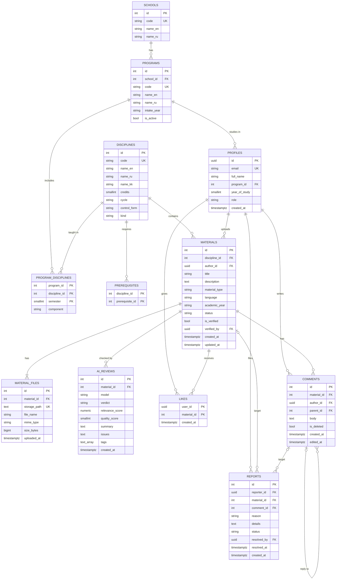

# База данных

PostgreSQL (Supabase). Схема создаётся файлами из папки `db/` в таком порядке:

1. `db/01_catalog.sql` — школы, специальности, дисциплины, пререквизиты
2. `db/02_core.sql` — профили, материалы, файлы, ИИ-проверки, лайки, комментарии, жалобы

Для локальной проверки в обычном PostgreSQL перед ними запускается `db/tests/00_local_auth_stub.sql`, после них — `db/tests/01_core_tests.sql`.

## ER-диаграмма

## Ключевые правила

| Правило | Где задано |
|---|---|
| Регистрация только с почтой `@kbtu.kz` | `profiles.email` CHECK |
| Один лайк на материал от одного студента | `likes` PRIMARY KEY (user_id, material_id) |
| Жалоба — ровно на материал или ровно на комментарий | `reports` CHECK |
| У закрытой жалобы обязательно есть дата решения | `reports` CHECK |
| Значок «проверено» только с указанием модератора | `materials` CHECK |
| Файл не больше 20 МБ | `material_files.size_bytes` CHECK |
| Удаление материала удаляет его файлы, лайки, комментарии, проверки | ON DELETE CASCADE |
| Удаление аккаунта сохраняет материалы без автора | ON DELETE SET NULL |

## Представления

- `material_cards` — карточка опубликованного материала: предмет, автор, число лайков и комментариев, последний вердикт ИИ.
